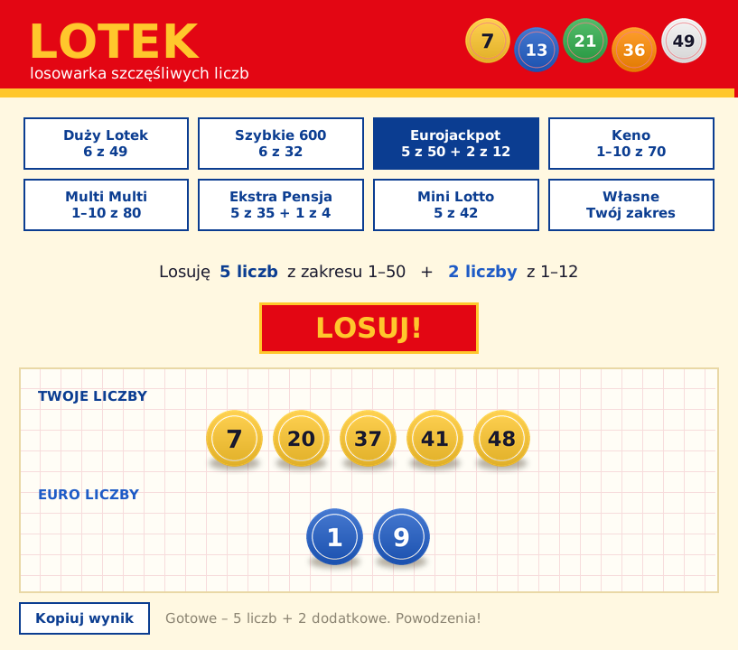

# Lotek 🎱

Prosta aplikacja na Windows, która losuje liczby do gier liczbowych.
Wybierasz grę, klikasz **LOSUJ!** albo naciskasz Enter, a kule spadają na swoje miejsca.



## Co potrafi

- Gotowe ustawienia gier:

  | Gra | Losowanie |
  |---|---|
  | Duży Lotek | 6 liczb z 1–49 |
  | Szybkie 600 | 6 liczb z 1–32 |
  | Eurojackpot | 5 liczb z 1–50 + 2 liczby z 1–12 |
  | Keno | 1–10 liczb z 1–70 (domyślnie 10) |
  | Multi Multi | 1–10 liczb z 1–80 (domyślnie 10) |
  | Ekstra Pensja | 5 liczb z 1–35 + 1 liczba z 1–4 |
  | Mini Lotto | 5 liczb z 1–42 |
  | Własne | Twój zakres „od–do” i ilość liczb (do 60 liczb, zakres do 9999) |

- Liczby nigdy się nie powtarzają, a obie granice zakresu biorą udział w losowaniu.
- Wynik jest posortowany od najmniejszej do największej liczby. Liczby dodatkowe są pokazane osobno, na niebieskich kulach.
- Losowanie korzysta z kryptograficznego generatora systemu (`secrets.SystemRandom`).
- Przycisk **Kopiuj wynik** kopiuje liczby do schowka, np. `4, 10, 12, 24, 42 + 8, 11`.

> Program tylko losuje liczby. Nie zwiększa szans na wygraną: każda kombinacja jest tak samo prawdopodobna. Graj odpowiedzialnie.

## Pobieranie

Gotowy plik `Lotek.exe` jest w zakładce **Releases**. Wystarczy go uruchomić, instalacja nie jest potrzebna.

Przy pierwszym uruchomieniu exe rozpakowuje się do `%LOCALAPPDATA%\nyorbee\Lotek\<wersja>`, a kolejne starty są szybsze.
Windows SmartScreen albo antywirus może ostrzec przed nieznanym programem. To częsty fałszywy alarm przy programach skompilowanych Nuitką.

## Uruchamianie ze źródeł

Potrzebujesz Pythona 3.10 lub nowszego (z Tkinterem, który jest w standardowym instalatorze na Windows).

```
pip install -r requirements.txt
python lotek.py
```


## Licencja

MIT – zobacz [LICENSE](LICENSE). Licencje użytych bibliotek: [THIRD_PARTY_NOTICES.md](THIRD_PARTY_NOTICES.md).

Created by IT Guy – https://www.facebook.com/ajtiguy
